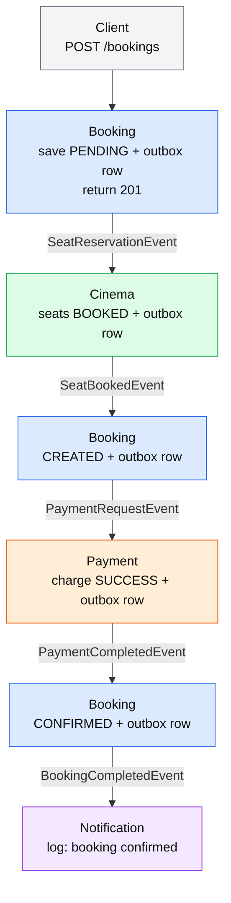
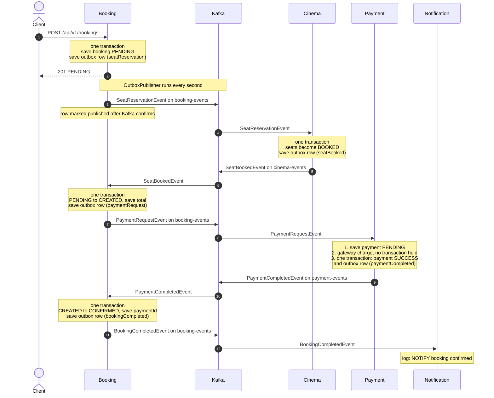
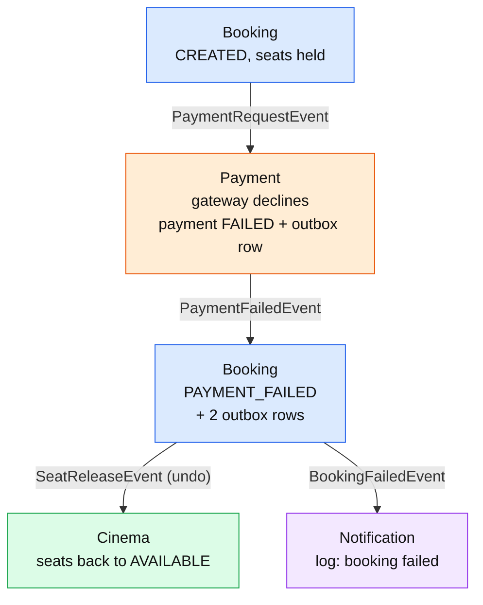
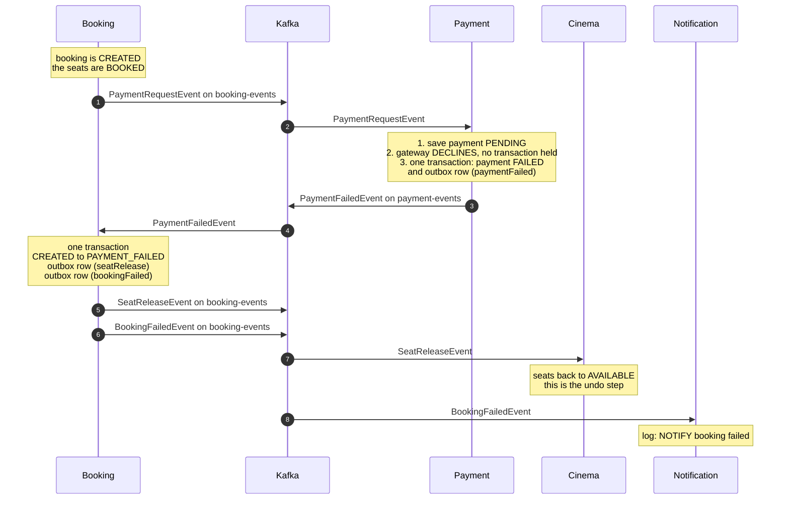

# Phase 7: Booking Flow with the Outbox

This file shows the booking flow when every service uses the **outbox pattern**.
It covers the happy path and one failure: the payment is declined.

## How the outbox works

- A service never sends to Kafka in the middle of its work.
- Instead, it saves an **outbox row** in the same database transaction as its own change.
  Both are saved, or neither is.
- A job called **OutboxPublisher** runs every second. It reads the unpublished rows in order,
  sends each one to Kafka, waits for Kafka's confirmation, and then marks the row as published.
- So an event cannot be lost after a database save, even if the service crashes or Kafka is down.

---

## 1. Happy path

### Simple flow

### Sequence diagram

### What to notice

- The client gets **201 with `PENDING`** at once. It reads the final status later with `GET /api/v1/bookings/{id}`.
- Every arrow into Kafka is the OutboxPublisher of the sending service, not the business code.
- Every service saves its own change and its outbox row in **one transaction**.
- Payment keeps the slow gateway call **outside** any transaction, so no database connection is held while it waits.
- Final data: booking `CONFIRMED`, seats `BOOKED`, payment `SUCCESS`.

---

## 2. Payment failed

### Simple flow

### Sequence diagram

### What to notice

- There is no shared transaction across services, so the undo is an explicit event: **`SeatReleaseEvent`**.
- Booking sends it, not Payment, because only Booking knows the show and the seat ids.
- Booking saves the status change and **both** outbox rows in one transaction, so it cannot end up
  `PAYMENT_FAILED` with the seats never released.
- Final data: booking `PAYMENT_FAILED`, seats `AVAILABLE`, payment `FAILED`.
