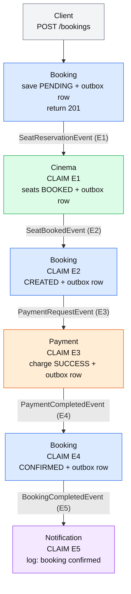
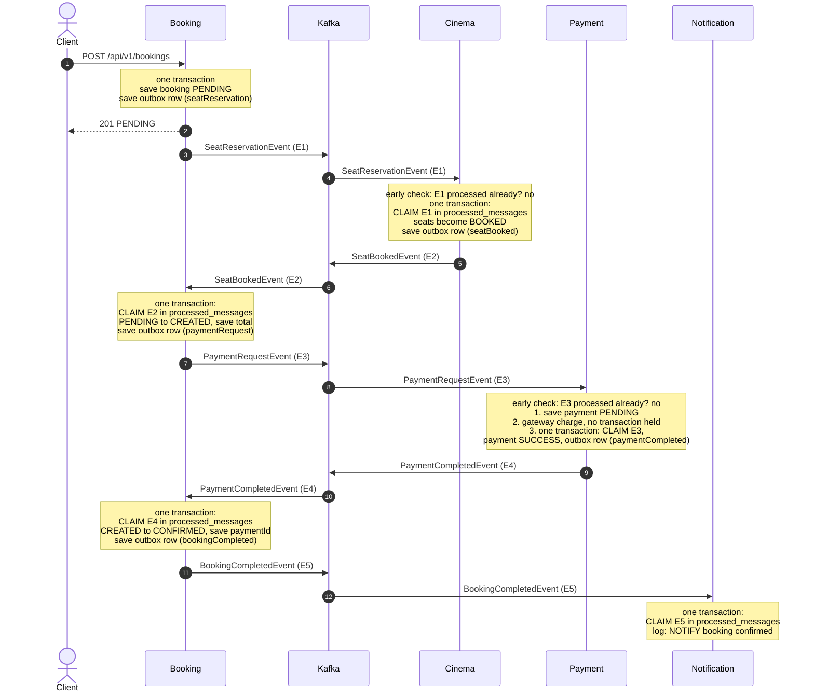

# Phase 7: Booking Flow with the Processed-Message Check

This file shows the **same happy path**, now with the idempotency check added to every consumer.
The outbox is still there. The new part is the **CLAIM** step in each service.

## Why it is needed

The outbox delivers every event **at least once**. If a service crashes after sending but before marking
the row as published, the same event is sent again. A repeated event must not do its work twice,
for example charge the customer twice or free seats that someone else has just booked.

## How the check works

- Every event has a unique `eventId`.
- Every consuming service has a table `processed_messages` with the `eventId` as primary key.
- Before doing its work, the consumer **claims** the `eventId` with
  `INSERT ... ON CONFLICT DO NOTHING`.
  - The insert adds a row: first time, so do the work.
  - The insert adds nothing: the event was already handled, so skip it.
- The claim and the work are in **one transaction**. If the work fails, the claim is rolled back too,
  so the retry runs the work again.
- Cinema and Payment also make a cheap early check (`isProcessed`) before slow work, so a repeated event never reaches the gateway.

---

## Happy path

### Simple flow

E1 to E5 are the `eventId` values. Each event has its own id.

### Sequence diagram

### What each service claims

After one happy-path booking, the `processed_messages` tables hold:

- **Cinema:** E1 (`SeatReservationEvent`)
- **Booking:** E2 (`SeatBookedEvent`) and E4 (`PaymentCompletedEvent`)
- **Payment:** E3 (`PaymentRequestEvent`)
- **Notification:** E5 (`BookingCompletedEvent`)

Booking has no row for E1, E3 or E5, because it only claims the events it **receives**, not the ones it sends.

### What to notice

- A claim and its work always share **one transaction**, so there is no state where the work is done but the claim is missing, or the reverse.
- Booking and Notification claim at the start of the work. Cinema and Payment also check early, before a seat update or a gateway call.
- The primary key on `message_id` is the last defence. Even if two threads race, only one insert can win.
- Final data is the same as before: booking `CONFIRMED`, seats `BOOKED`, payment `SUCCESS`.

### When the same event arrives again

For example, E3 (`PaymentRequestEvent`) is delivered a second time:

- Payment's early check finds E3 in `processed_messages`, logs `already processed, skipped`, and stops.
- No second payment row is created, and the gateway is never called.
- The same applies to every other consumer: a repeated event is skipped, and its work is not done again.
