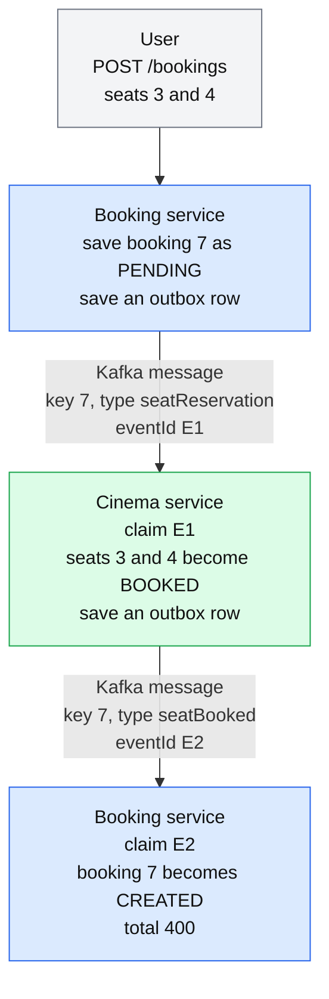
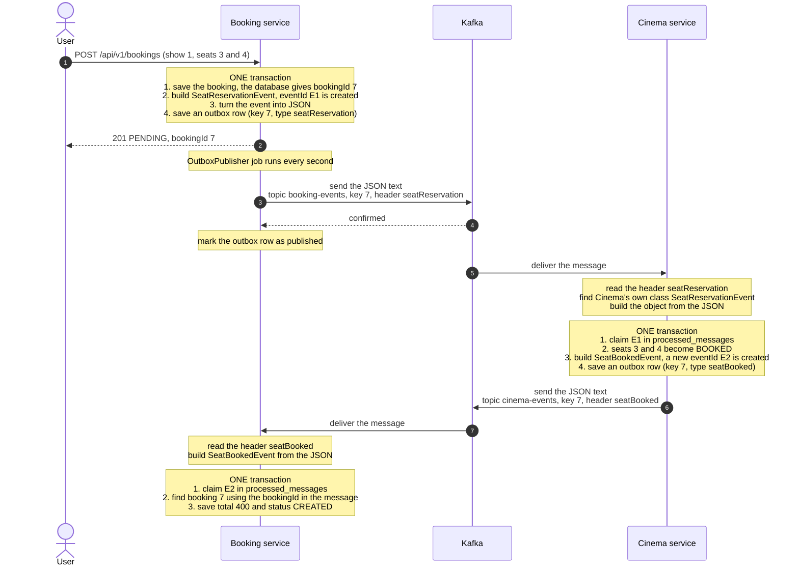
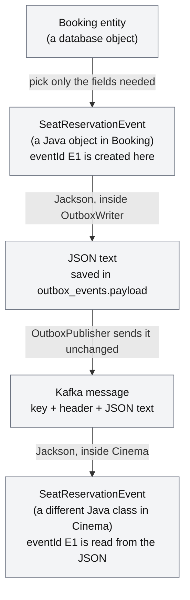
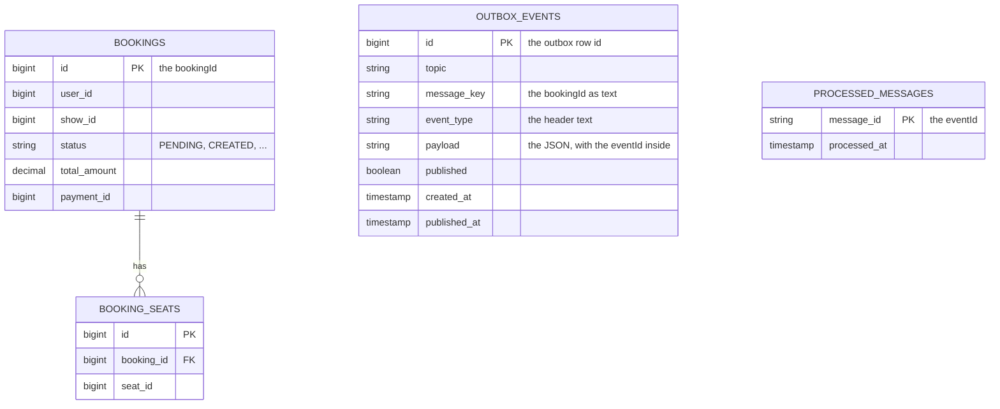

# How Ids and Events Travel: Booking to Cinema and Back

This guide follows **one booking** from the controller to the Cinema service and back to Booking.
Payment is left out, so the story ends when the booking becomes `CREATED`.

You will learn:
- how a booking becomes an event, then JSON, then a Kafka message, then an event again
- what the topic, the key and the header are for
- which id answers which question
- how the outbox and the processed-message check use these ids

---

## 1. The example

User 12 books seats 3 and 4 of show 1. Each seat costs 200.

```
POST /api/v1/bookings
{ "showId": 1, "seatIds": [3, 4] }
```

Names used in this guide:
- **bookingId = 7** (the database gives it to the booking)
- **E1** = the id of the first event (Booking to Cinema)
- **E2** = the id of the second event (Cinema back to Booking)

---

## 2. The big picture



In one sentence: Booking asks Cinema to hold the seats, Cinema answers, and Booking updates the booking.
The two services never call each other directly. They only leave messages in Kafka.

---

## 3. Step by step



### Step 1: Booking saves the booking and an outbox row

- The user id (12) comes from the JWT token, not from the request body.
- The database creates the **bookingId** (7).
- Booking builds an event from only the fields Cinema needs. The `Booking` entity itself is never sent.
- `BaseEvent` creates the **eventId** (E1), a random UUID, the moment the event object is created.
- `OutboxWriter` turns the event into JSON text and saves it in the `outbox_events` table.
- The booking and the outbox row are saved in **one transaction**. Both are saved, or neither is.

### Step 2: The OutboxPublisher sends the row

- A job runs every second and reads the rows that are not published yet.
- It sends the saved JSON text **as it is**. It does not build a new event.
- After Kafka confirms, it marks the row as published.

### Step 3: Cinema receives the message

- Cinema reads the topic `booking-events`.
- It reads the header `seatReservation` and looks it up in its own `type.mapping` setting.
  That points to Cinema's own `SeatReservationEvent` class.
- Jackson builds that object from the JSON.
- Events that Cinema does not need are mapped to an empty `IgnoredEvent` class and skipped.

### Step 4: Cinema reserves the seats

- It claims E1 in its own `processed_messages` table, so the same event is never handled twice.
- It marks seats 3 and 4 as `BOOKED` and works out the total (2 x 200 = 400).
- It builds a **new event**, `SeatBookedEvent`, with its own new eventId (E2).
- It saves an outbox row. The claim, the seats and the row are saved in **one transaction**.

### Step 5 and 6: Booking gets the answer

- The same steps happen in the other direction, through the topic `cinema-events`.
- Booking claims E2, finds booking 7 using the bookingId in the message, saves the total 400 and sets `CREATED`.

---

## 4. From a booking object to JSON and back



Things to remember:
- The JSON is made **once**, when the row is saved. The publisher only sends that text.
  So if a row is sent twice, both messages are exactly the same, with the same eventId.
- Booking's class and Cinema's class are **two different Java classes**. They do not share code.
  The agreement between them is the **JSON field names** and the **header name**.
- The producer must use `StringSerializer`. The JSON is already made, so it must not be converted again.

The JSON in this example:

```json
{
  "bookingId": 7,
  "showId": 1,
  "seatIds": [3, 4],
  "eventId": "E1",
  "occurredAt": "2026-10-11T11:56:46Z"
}
```

---

## 5. What is inside a Kafka message

```
topic      booking-events           which notice board
partition  chosen by Kafka          which lane on the board, picked from the key
offset     position in the lane     a reader remembers where it stopped
key        "7"                      the bookingId as text
header     __TypeId__ = seatReservation     what kind of event this is
value      {"bookingId":7,"showId":1,"seatIds":[3,4],"eventId":"E1", ...}
```

- **Topic:** a named notice board. Booking writes to `booking-events`, Cinema writes to `cinema-events`.
- **Key:** Kafka uses it to pick the partition. The same key always goes to the same partition,
  so all events of booking 7 are read **in order**.
- **Header:** the label on the envelope. It tells the receiver which class to build.
  The sender and receiver must use the same label text, for example `seatReservation`.
- **Value:** the JSON text with the data.
- **Consumer group:** the name of a reading service, for example `cinema-service`.
  Each group gets its own full copy of every message, so Cinema and Notification can both read `booking-events`.

---

## 6. Which id answers which question

- **bookingId (7):** *Which booking is this about?*
  The database creates it. Every event carries it. It is also used as the Kafka key.
- **eventId (E1, E2):** *Have I already handled this event?*
  `BaseEvent` creates it once. It is used only for the duplicate check.
- **showId and seatIds:** *Which seats does Cinema reserve?*
  They belong to Cinema. Booking copies them into the event.
- **userId (12):** *Who is the user?*
  It comes from the JWT. It stays in Booking, and Cinema does not need it.
- **Header (seatReservation):** *What kind of event is this?*
  It decides which class is built and which handler method runs.
- **Kafka key (7):** *Which partition? In which order?*
- **Outbox row id (41):** *Which row should the job send next?*
  It only gives the order inside one service's outbox table. It is never sent to Kafka.
- **Partition and offset:** *Where is the message in Kafka?*
  A reader uses them to remember its position. They are not business ids.
- **Consumer group (cinema-service):** *Which service is reading?*

Two common questions:
- **How does Cinema know which kind of event arrived?** From the header, never from the fields.
  Two events with the same fields still go to different handlers, because their headers are different.
- **Why do the request and the answer have different eventIds if both are about booking 7?**
  They are two different events. The bookingId says which booking they are about,
  and the eventId says which event it is.

---

## 7. The tables



- `bookings` and `booking_seats` belong to **Booking**. The outbox and processed tables have no foreign keys.
  They link to other data only by value: the `message_key` is a bookingId, and the eventId is inside the `payload`.
- **Every service has its own copy** of `outbox_events` and `processed_messages`,
  in its own database. Booking, Cinema and Payment have both tables. Notification has only `processed_messages`,
  because it sends nothing.
- After this example, the tables hold:
  - Booking: two outbox rows (`seatReservation`, then later `paymentRequest`) and one processed row, E2.
  - Cinema: one outbox row (`seatBooked`) and one processed row, E1.

---

## 8. The outbox: why we do not send straight to Kafka

Saving to the database and sending to Kafka are two different actions.
If the service crashes between them, the booking is saved but the message is lost.
Booking 7 would stay `PENDING` forever.

The outbox fixes this:
- The message is saved in the same transaction as the booking.
  If the booking is saved, the message is saved too.
- A separate job sends it later. If Kafka is down, the row waits and is sent when Kafka is back.
- The job marks a row as published only after Kafka confirms. If the service crashes right after sending,
  but before marking, the row is sent **again**. So messages arrive **at least once**, and sometimes twice.

That is why the next part exists.

---

## 9. The processed-message check: why we need unique ids

Because a message can arrive twice, the receiver must not do the work twice.
For example, Cinema must not reserve the same seats again, or free seats that someone else booked.

How it works in Cinema, for E1:

1. The first time: Cinema runs `INSERT INTO processed_messages (message_id) VALUES ('E1') ON CONFLICT DO NOTHING`.
   The result is **1 row added**, so this is the first time. Cinema does the work.
2. The same message arrives again: the same insert adds **0 rows**, because E1 is already there.
   Cinema skips the work and logs `already processed, skipped`.

Rules that make it safe:
- The claim and the work are in **one transaction**. If the work fails, the claim is rolled back too,
  so the retry does the work again.
- The `message_id` is the **primary key**, so even two threads at the same time cannot both claim E1.
- The eventId is created **once**, and the JSON is saved once. A re-sent message has the same eventId,
  so it is recognised. A new action creates a new event with a new id.
- Each service keeps its own table and claims only the events it **receives**. Booking has E2, and Cinema has E1.

---

## 10. Things that can go wrong

- **The producer uses the JSON serializer instead of the string serializer.**
  The JSON is converted twice. The message value starts with a quote mark and the header becomes `java.lang.String`.
  Nobody can read it, so Cinema never reacts.
- **The header text is spelled differently on the two sides.**
  The receiver cannot find the class, so the message fails or is ignored.
- **The config change was not committed.**
  The Config Server reads from GitHub, so a change that exists only on your machine is not used.
  Check `http://localhost:8888/<service-name>/default`.
- **`BaseEvent` lost its field or its setter in one service.**
  Every message gets a new random eventId, so every duplicate looks new. Nothing fails, but the check stops working.
  Keep `BaseEvent` the same in all services.

---

## 11. Short summary

- A booking becomes a small **event object**, then **JSON text**, then a **Kafka message**, then an event object again in the other service.
- The **header** says what kind of event it is. The **key** keeps one booking's events in order. The **bookingId** says which booking it is about.
- The **outbox** makes sure a message is never lost after a save. The **processed-message check** makes sure a message is never handled twice.
- The **eventId** is the only id used for the duplicate check.

**Interview line:** "I save the event in an outbox table in the same transaction as the data, so it cannot be lost.
Delivery is at least once, so every consumer claims the eventId in the same transaction as its work, and a repeated event is skipped."
