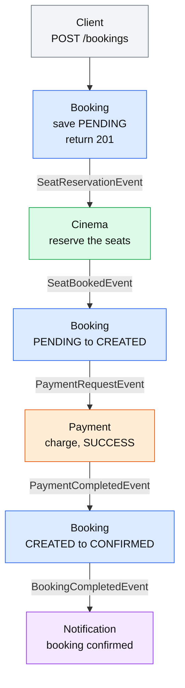
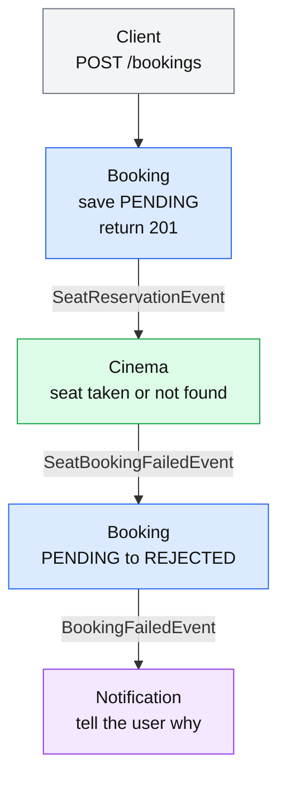
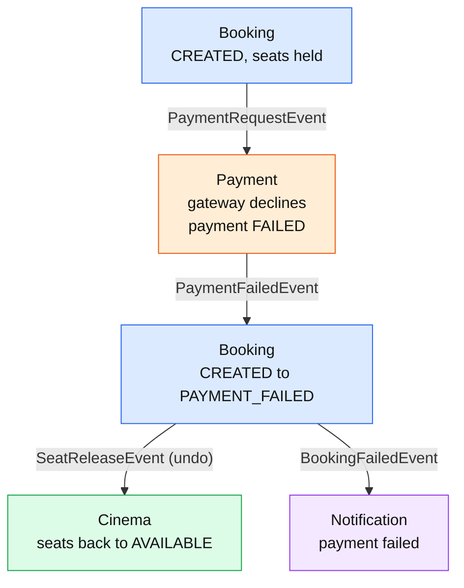
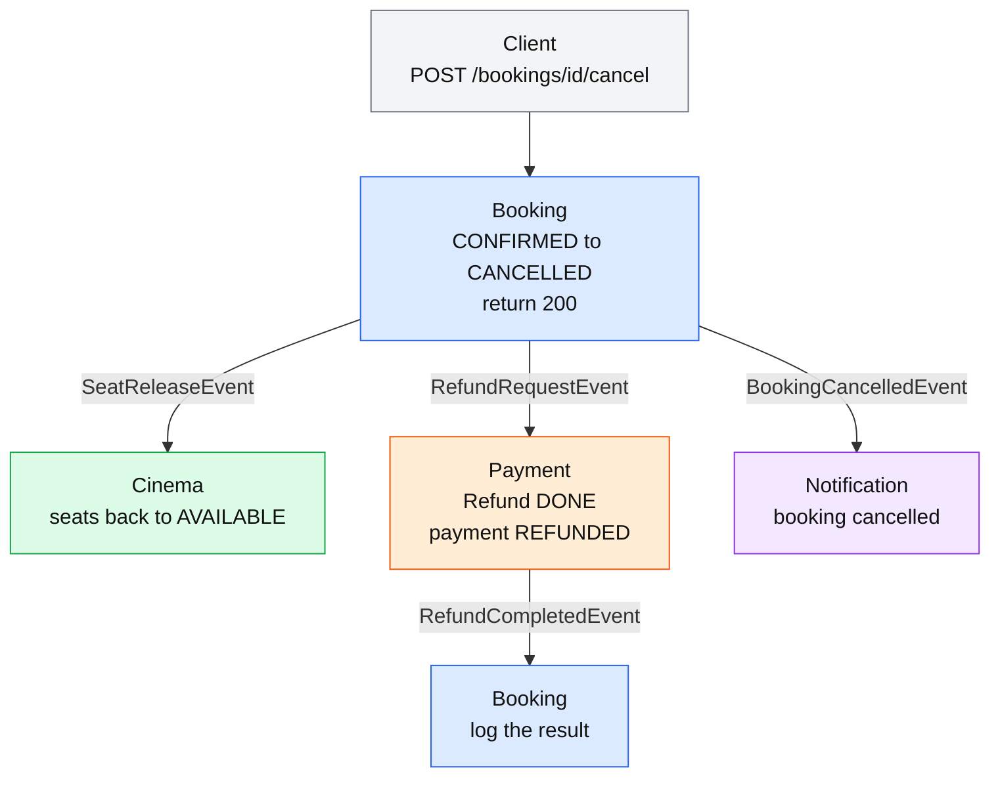
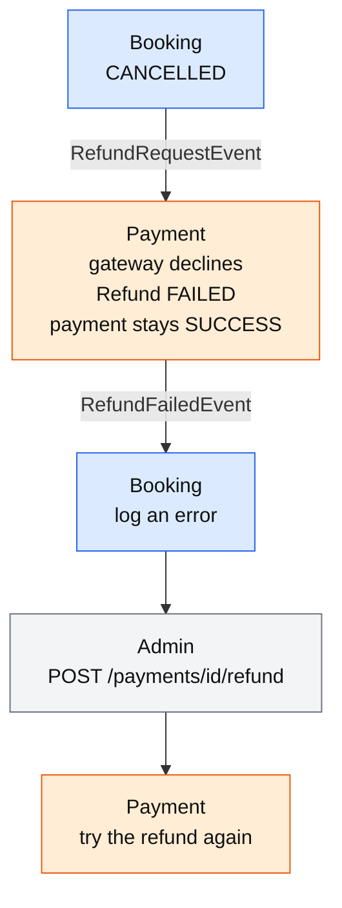
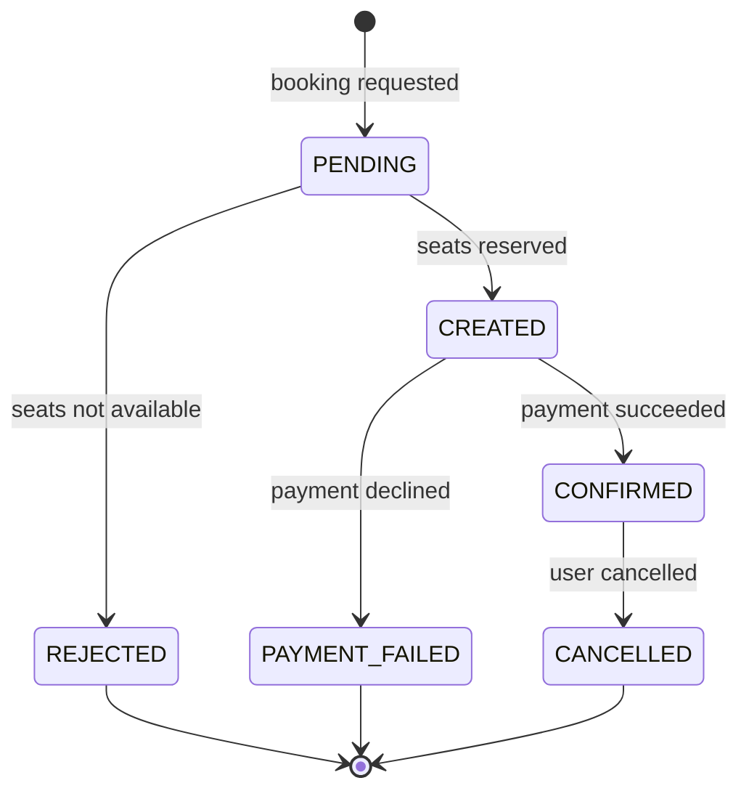

# Phase 7: Booking and Cancel Flows (simple version)

Every scenario has a step-by-step chain and a small diagram of the same flow. Read each chain from top to bottom. A line like `Cinema -> Booking: SeatBookedEvent` means Cinema publishes that event and Booking reacts to it.

---

## 1. Booking API: `POST /api/v1/bookings`

The client gets **201 with status `PENDING`** at once. The rest happens through events. The client reads the final status with `GET /api/v1/bookings/{id}`.

### Happy path
```
1. Client  -> Booking:       POST /bookings
2. Booking:                  save PENDING, return 201
3. Booking -> Cinema:        SeatReservationEvent
4. Cinema:                   reserve the seats
5. Cinema  -> Booking:       SeatBookedEvent
6. Booking:                  PENDING to CREATED, save the total
7. Booking -> Payment:       PaymentRequestEvent
8. Payment:                  charge the fake gateway, payment SUCCESS
9. Payment -> Booking:       PaymentCompletedEvent
10. Booking:                 CREATED to CONFIRMED, save the paymentId
11. Booking -> Notification: BookingCompletedEvent
12. Notification:            tell the user the booking is confirmed
```



### Failure 1: seats not available
```
1-3. same as the happy path
4. Cinema:                   a seat is taken, not found, or another user won the race
5. Cinema  -> Booking:       SeatBookingFailedEvent
6. Booking:                  PENDING to REJECTED
7. Booking -> Notification:  BookingFailedEvent
8. Notification:             tell the user why it failed
```


No seats were held, so nothing needs undoing.

### Failure 2: payment declined
```
1-7. same as the happy path
8. Payment:                  gateway declines, payment FAILED
9. Payment -> Booking:       PaymentFailedEvent
10. Booking:                 CREATED to PAYMENT_FAILED
11. Booking -> Cinema:       SeatReleaseEvent          (the undo step)
12. Cinema:                  seats back to AVAILABLE
13. Booking -> Notification: BookingFailedEvent
14. Notification:            tell the user the payment failed
```



---

## 2. Cancel API: `POST /api/v1/bookings/{id}/cancel`

The client gets **200 with status `CANCELLED`** at once, before the seats are released and before the refund finishes.

### Errors before anything happens
- **401:** missing or invalid token
- **404:** the booking does not exist, or it belongs to another user
- **409:** the booking is not `CONFIRMED`. Only a confirmed booking can be cancelled.

### Happy path
```
1. Client  -> Booking:       POST /bookings/{id}/cancel
2. Booking:                  lock the row, CONFIRMED to CANCELLED, return 200
3. Booking -> Cinema:        SeatReleaseEvent
4. Booking -> Payment:       RefundRequestEvent
5. Booking -> Notification:  BookingCancelledEvent       (steps 3 to 5 happen together)
6. Cinema:                   seats back to AVAILABLE
7. Payment:                  save Refund PENDING, ask the gateway
8. Payment:                  Refund DONE, payment REFUNDED
9. Payment -> Booking:       RefundCompletedEvent
10. Booking:                 log the result
11. Notification:            tell the user the booking is cancelled
```



### Failure: refund declined
```
1-6. same as the happy path
7. Payment:                  gateway declines the refund
8. Payment:                  Refund FAILED, payment stays SUCCESS
9. Payment -> Booking:       RefundFailedEvent
10. Booking:                 log an error
11. Admin  -> Payment:       POST /payments/{id}/refund   (ADMIN role, retry)
```


The booking stays `CANCELLED` and the seats are already free. Only the money is waiting.

---

## 3. Booking status changes



Each change is guarded. A repeated message finds a different status and is skipped.

- `PENDING` moves only to `CREATED` or `REJECTED`.
- `CREATED` moves only to `CONFIRMED` or `PAYMENT_FAILED`.
- Only `CONFIRMED` can be cancelled.

### Other statuses that change along the way
- **Seat:** `AVAILABLE` to `BOOKED` when reserved. `BOOKED` back to `AVAILABLE` when released.
- **Payment:** `PENDING` to `SUCCESS` or `FAILED`. `SUCCESS` to `REFUNDED` after a refund.
- **Refund:** `PENDING` to `DONE` or `FAILED`.

---

## 4. Outcomes

**Booking API**
- **Booked:** booking `CONFIRMED`, seats `BOOKED`, payment `SUCCESS`.
- **Seats not available:** booking `REJECTED`, no seats held, no payment.
- **Payment declined:** booking `PAYMENT_FAILED`, seats back to `AVAILABLE`, payment `FAILED`.

**Cancel API**
- **Cancelled and refunded:** booking `CANCELLED`, seats `AVAILABLE`, payment `REFUNDED`, refund `DONE`.
- **Cancelled, refund failed:** booking `CANCELLED`, seats `AVAILABLE`, payment still `SUCCESS`, refund `FAILED`, waiting for an admin retry.
- **Not cancelled:** 404 or 409, and nothing changes.

---

## 5. Still open (fixed in Steps 6 to 9)
- A crash between the database save and the Kafka publish loses the event.
- A message that arrives twice is processed twice.
- A bad message can block a consumer.
- A booking can stay `PENDING` or `CREATED` if the next service never answers.
