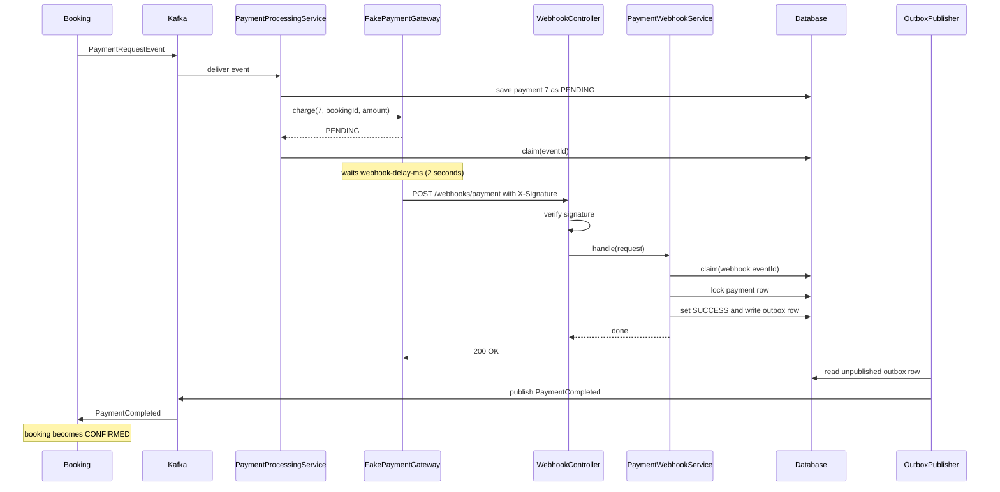
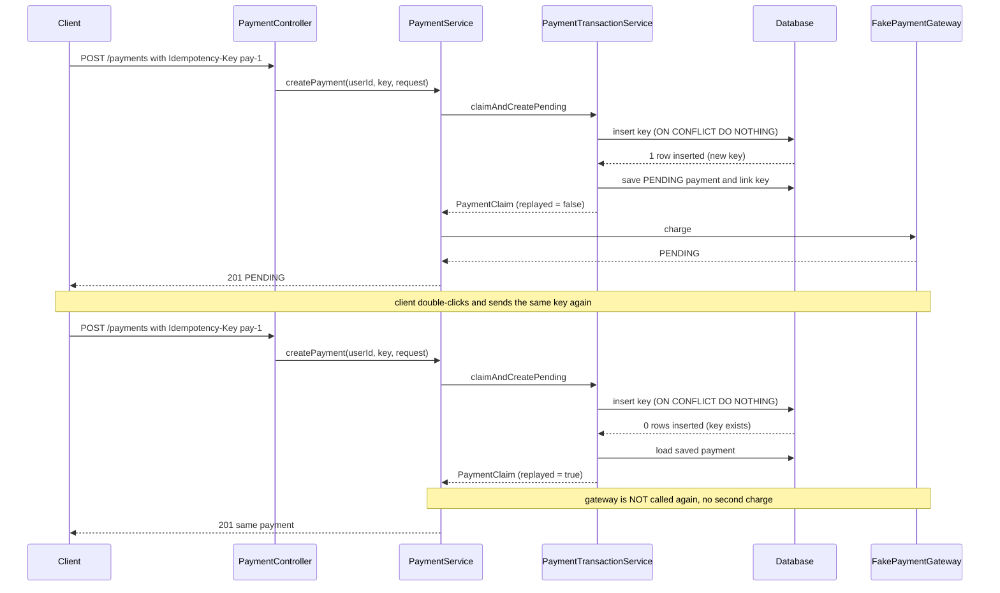
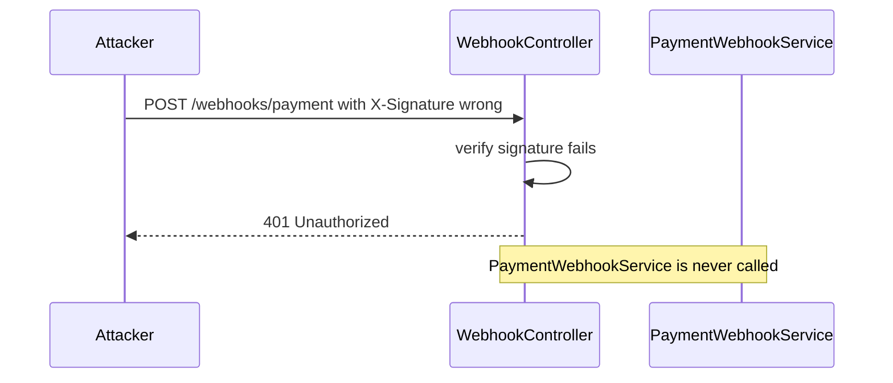
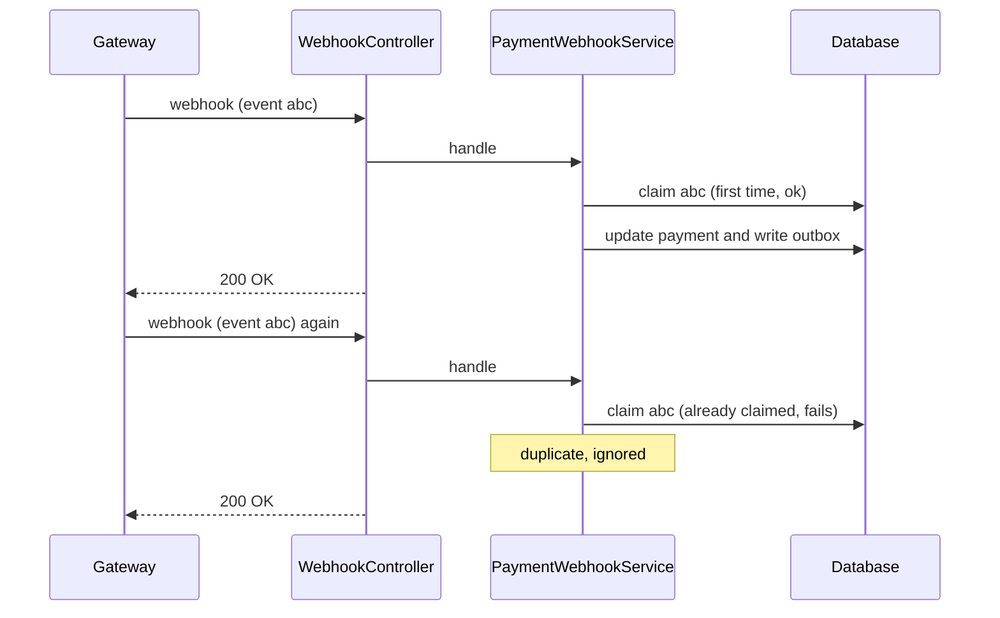
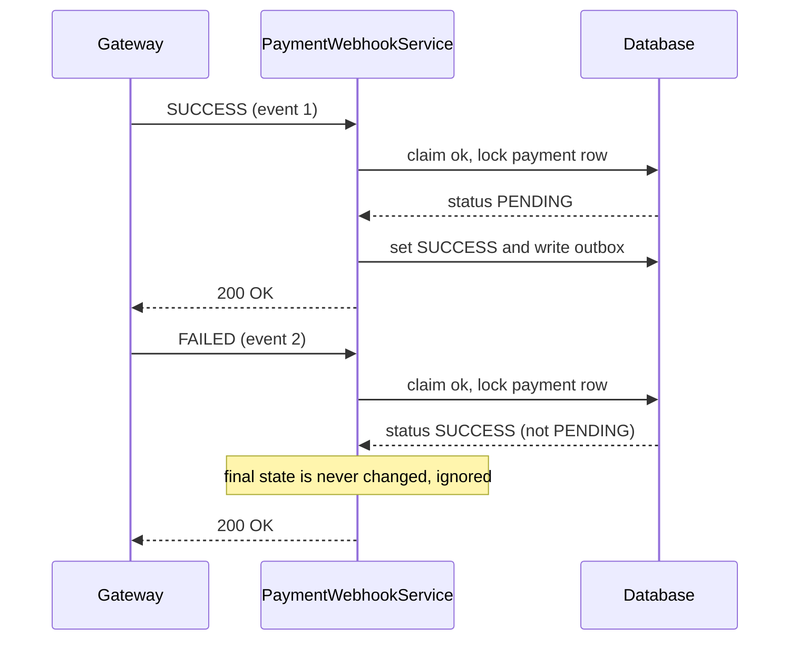
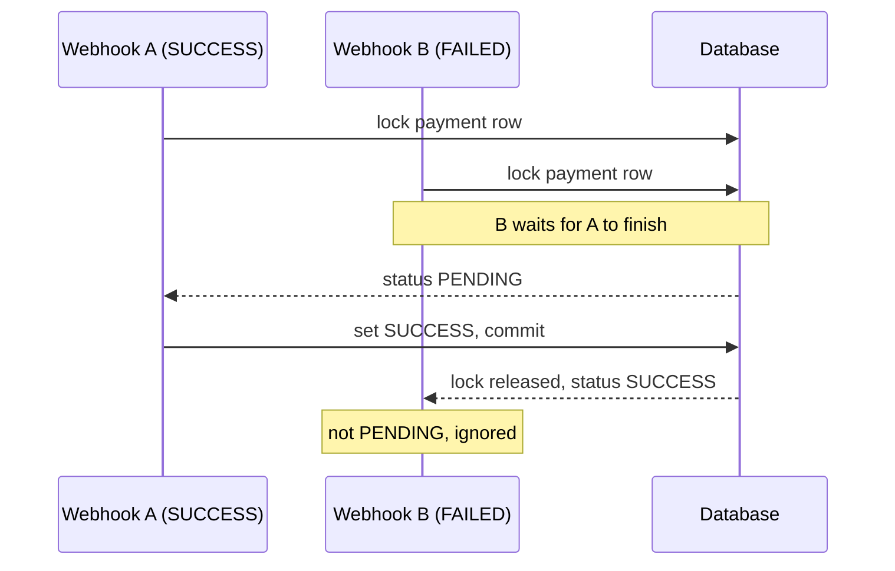

# Payment Gateway and Webhook Flow

Phase 8, Step 2. How the fake gateway answers `PENDING`, how it calls our webhook later, and how the webhook finishes the payment safely.

**Contents**
1. Classes and their functions
2. Overall flow
3. Each flow in depth
4. Sequence diagrams
5. Important points and notes

---

## 1. Classes and their functions

### The idea in one paragraph

A real bank does not always answer immediately. So `FakePaymentGateway` behaves like a real one: when we charge, it replies `PENDING` straight away, waits a couple of seconds, then calls our webhook with the final result. The webhook endpoint verifies the call came from the gateway, ignores duplicates and late calls, and finishes the payment.

### Gateway side

- **`PaymentGateway` (interface)**
  - Strategy pattern. `PaymentService` knows only this interface, so a real provider can replace the fake one later.
  - Methods: `charge(paymentId, bookingId, amount)` and `refund(bookingId, amount)`.
  - `paymentId` was added to `charge`, because the gateway sends it back in the webhook so we know which payment the result is for.

- **`GatewayStatus` and `GatewayResult`**
  - The gateway's answer: `SUCCESS`, `FAILED` or `PENDING`, plus a message.
  - Helpers: `isSuccess()`, `isPending()`.
  - Static factories: `success()`, `failed()`, `pending()`.

- **`FakePaymentGateway`**
  - Our pretend bank, with two modes controlled by config.
  - **Sync mode** (`async-enabled: false`): approves if the amount is within `max-amount`, otherwise declines, and answers right away.
  - **Async mode** (`async-enabled: true`):
    1. Decide the outcome now (approved if amount is at most `max-amount`).
    2. Schedule a task on a small thread pool, delayed by `webhook-delay-ms` (default 2000 ms).
    3. Return `PENDING` immediately.
    4. When the delay passes, build the webhook body, sign it, and POST it to our webhook URL using `RestClient`.
  - Other flags: `send-duplicate-webhook` (send every webhook twice), `fail-refunds`, `webhook-url`.

### Webhook side

- **`WebhookController`**
  - Public endpoint `POST /api/v1/webhooks/payment`.
  - Reads the `X-Signature` header, asks `WebhookSignatureService` to verify, then calls `PaymentWebhookService`.
  - Wrong signature gives `401`. Everything else, including duplicates and ignored calls, returns `200`.

- **`WebhookSignatureService`**
  - Used by both sides: the gateway signs, the controller verifies.
  - Computes HMAC-SHA256 of `eventId|paymentId|status` with a shared secret.
  - Compares with `MessageDigest.isEqual` (constant-time).

- **`PaymentWebhookService`**
  - The brain. One transaction does the duplicate check, row lock, status check, final status and outbox event.

- **`PaymentWebhookRequest`**
  - The webhook body: `eventId`, `paymentId`, `status`, with validation (`status` must be `SUCCESS`, `FAILED` or `PENDING`).

- **`InvalidWebhookSignatureException`**
  - Thrown on a bad signature, mapped to `401` by `GlobalExceptionHandler`.

### Supporting classes

- **`SecurityConfig`**: `POST /api/v1/webhooks/payment` is `permitAll`, because the gateway has no JWT. The refund rule is placed before the broad `/api/v1/payments/**` rule so `hasRole("ADMIN")` applies.
- **`PaymentRepository.findByIdForUpdate`**: `SELECT ... FOR UPDATE` (pessimistic lock) on the payment row.
- **`IdempotencyService.claim`**: records the `eventId` in `processed_messages`. The first caller wins.
- **`PaymentEventRecorder`**: writes `PaymentCompleted` or `PaymentFailed` to the outbox table.
- **`PaymentProcessingService` and `PaymentService`**: call `charge()`. If the result is `PENDING`, they stop and wait for the webhook.

---

## 2. Overall flow

### Big picture

```
Payment service                         Fake gateway
      |                                      |
      |--- charge(paymentId 7) ------------->|
      |<-- PENDING (answers right away) -----|
      |                                      |
      |        (2 seconds pass)              |
      |                                      |
      |<-- webhook: payment 7 = SUCCESS -----|
      |    (signed with X-Signature)         |
      |                                      |
   update payment to SUCCESS
   tell Booking through Kafka
```

### Full flow with timing (async mode)

```
t = 0 ms       Booking sends PaymentRequestEvent through Kafka
                  |
t = ~10 ms     PaymentProcessingService
                  saves payment #7 as PENDING
                  |
t = ~20 ms     gateway.charge(7, bookingId, amount)
                  gateway schedules the callback, returns PENDING
                  |
               PaymentProcessingService
                  claims the event id, stops
                  (booking is CREATED, payment is PENDING)

t = 2000 ms    Gateway sends the signed webhook
                  |
               WebhookController -> signature ok
                  |
               PaymentWebhookService
                  claim ok, lock row, status PENDING,
                  set SUCCESS, write PaymentCompleted to outbox
                  |
               reply 200

t = ~2100 ms   OutboxPublisher sends PaymentCompleted to Kafka
                  |
               Booking consumes it -> booking becomes CONFIRMED
```

If the amount is above `max-amount`, the gateway sends `FAILED`. The webhook then writes `PaymentFailed`, and Booking runs the compensation from Phase 7.

### Three safety checks in one view

```
Incoming webhook
   |
   v
[1] Signature valid?        NO  -> 401
   |
   v
[2] Event id new?           NO  -> ignore, 200
   |
   v
[3] Payment still PENDING?  NO  -> ignore, 200
   |
   v
Update the payment and write the outbox event
```

---

## 3. Each flow in depth

### Flow A: Gateway side, what `charge()` does

```
PaymentService or PaymentProcessingService
   |
   |  gateway.charge(paymentId, bookingId, amount)
   v
FakePaymentGateway
   |
   |  approved = amount <= max-amount ?
   |
   +-- async-enabled = false (sync mode)
   |       return SUCCESS or FAILED right away
   |
   +-- async-enabled = true (async mode)
           1. schedule a task to run after webhook-delay-ms (2000 ms)
           2. return PENDING right away

   ... 2 seconds later, the scheduled task runs ...

   sendWebhook()
      1. eventId   = new UUID
      2. status    = approved ? SUCCESS : FAILED
      3. signature = HMAC-SHA256(secret, eventId|paymentId|status)
      4. POST /api/v1/webhooks/payment
              header: X-Signature = signature
              body:   { eventId, paymentId, status }
      5. if send-duplicate-webhook = true, POST the same call again
```

### Flow B: Caller side after `charge()` returns `PENDING`

**Kafka path (`PaymentProcessingService.process`)**
```
isProcessed(eventId)?  YES -> skip
   |
createPending          (commits PENDING payment)
   |
gateway.charge         (no transaction)
   |
result is PENDING?
   YES -> short transaction: claim(eventId), then stop
   NO  -> (sync mode) one transaction: claim + finish + outbox event
```

**REST path (`PaymentService.createPayment`)**
```
claimAndCreatePending  (idempotency key + PENDING payment)
   |
gateway.charge
   |
result is PENDING?
   YES -> return the PENDING payment in the response (201)
   NO  -> (sync mode) finish() and return the final payment
```

### Flow C: Webhook side, what happens when the call arrives

```
Gateway POST /api/v1/webhooks/payment
   |
   v
SecurityConfig
   |  path is permitAll (no JWT, the gateway has none)
   v
WebhookController
   |  validate the body (eventId, paymentId, status)
   |
   |  signature valid?  (WebhookSignatureService recomputes the HMAC)
   |        NO  -> 401, stop
   |        YES -> continue
   v
PaymentWebhookService                         (ONE transaction)
   |
   |  1. claim(eventId)
   |        fails  -> duplicate, ignore, reply 200
   |        ok     -> continue
   |
   |  2. lock payment row (SELECT ... FOR UPDATE)
   |        not found -> 404 (transaction rolls back, claim undone)
   |
   |  3. payment status still PENDING?
   |        NO  -> late or out-of-order call, ignore, reply 200
   |        YES -> continue
   |
   |  4. webhook status is PENDING?   -> still processing, ignore, reply 200
   |
   |  5. status SUCCESS -> payment = SUCCESS, write PaymentCompleted to outbox
   |     status FAILED  -> payment = FAILED,  write PaymentFailed to outbox
   |
   v
commit, reply 200
```

### Flow D: Bad cases

**Fake caller**
```
POST webhook with a wrong X-Signature
   -> WebhookController: signature invalid
   -> 401, nothing changes
```

**Same webhook twice**
```
Call 1: claim(eventId) ok       -> payment updated, 200
Call 2: claim(eventId) fails    -> ignored, 200
```

**Late FAILED after SUCCESS**
```
Call 1: SUCCESS -> payment = SUCCESS
Call 2: FAILED  -> payment is not PENDING -> ignored, 200
```

**Two different webhooks at the same time**
```
Webhook A: lock row  -> reads PENDING -> sets SUCCESS -> commit
Webhook B: waits for the lock ... -> reads SUCCESS -> ignored
```

**Our service fails while handling**
```
PaymentWebhookService throws
   -> whole transaction rolls back (the event claim too)
   -> error returned
   -> gateway retries later -> processed normally
```

**Gateway cannot reach us**
```
Fake gateway: logs the error, does not retry
Real gateway: would retry with backoff
```

---

## 4. Sequence diagrams

### Happy path (Kafka booking, async gateway)



### REST payment with an Idempotency-Key (new key, then repeat)



### Bad signature



### Duplicate webhook (send-duplicate-webhook: true)



### Late webhook after the payment is final



### Two different webhooks at the same time



---

## 5. Important points and notes

### Why a webhook and not a normal response

- A real payment is not always finished in one call (OTP, bank approval, UPI confirmation).
- The webhook lets the gateway tell us the result when it is ready, so we never poll.

### Why the webhook is on Payment, not Booking

- The gateway only knows payments, not bookings.
- Payment owns the `Payment` table and the gateway details (secret, signature format).
- Booking learns the result through the Kafka event `PaymentCompleted` or `PaymentFailed`.

### Security

- The webhook is `permitAll`, because the gateway has no JWT. The signature is its proof of identity.
- We sign `eventId|paymentId|status` instead of the raw body. This keeps the code simple. Real providers often sign the raw body, which needs the unparsed request.
- The signature comparison uses `MessageDigest.isEqual` so timing cannot leak how many characters matched.
- The shared secret comes from config or an environment variable (`WEBHOOK_SECRET`), never from code. There is no default in code, so the app will not start if it is missing.
- In real life, the webhook is exposed through the API Gateway and must be exempt from JWT checks there too. The fake gateway calls Payment directly, so this is not needed here.

### Consistency

- The claim, the status change and the outbox row commit together. If anything fails, all of it rolls back, and the gateway's retry is processed normally.
- A final state (`SUCCESS`, `FAILED`, `REFUNDED`) is never changed by a webhook.
- `SELECT ... FOR UPDATE` (the Phase 4 pessimistic lock) stops two different webhooks from both reading `PENDING`.
- Returning `200` for duplicates and ignored calls tells the gateway to stop retrying. Only a wrong signature returns an error (`401`).

### Config flags (in the config repo, `payment-service` file)

```yaml
payment:
  gateway:
    async-enabled: true            # false = old instant behaviour
    webhook-delay-ms: 2000
    send-duplicate-webhook: false  # true = send every webhook twice
  webhook:
    secret: ${WEBHOOK_SECRET:dev-only-secret}
```

### Known gaps and side effects

- **Double-charge window in the Kafka path.** If the service crashes after the gateway call but before the claim, Kafka redelivers and a second payment is created. Same window as Phase 7. Options for later: claim first plus a recovery job for stuck `PENDING` payments, or send our `paymentId` to the gateway as its own idempotency reference.
- **Stuck `PENDING` payments.** If the webhook never arrives, the payment stays `PENDING`. A real system adds a reconciliation job that asks the gateway for the status. Suggested for Phase 10.
- **REST payments now publish events too.** Webhooks write `PaymentCompleted` or `PaymentFailed` for REST-created payments as well. Test with Kafka-created bookings.
- **The fake gateway does not retry** a failed webhook delivery. It only logs the error.

### How to test it by hand

- Set `webhook-delay-ms: 10000`, then watch `GET /payments/{id}` stay `PENDING` and flip to `SUCCESS`.
- Set `send-duplicate-webhook: true`, then look in the logs for "already processed, ignored".
- Send a webhook by hand with `X-Signature: wrong` and expect `401`:

```
curl -i -X POST http://localhost:<payment-port>/api/v1/webhooks/payment \
  -H "Content-Type: application/json" \
  -H "X-Signature: wrong" \
  -d '{"eventId":"e1","paymentId":1,"status":"SUCCESS"}'
```

### Interview line

"Idempotency keys make client retries safe, and webhooks with signature checks handle async payment results. Duplicates are ignored by event id, and late calls can never overwrite a final state."
